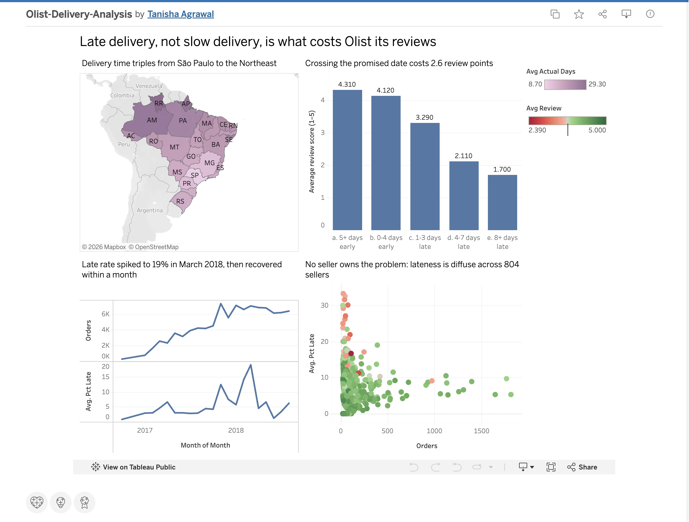

# Olist E-Commerce Delivery & Review Analysis

Quantifying how delivery performance drives customer satisfaction across
~100K Brazilian e-commerce orders (2016–2018).

**Stack:** PostgreSQL → Tableau Public

**[View the interactive dashboard](https://public.tableau.com/app/profile/tanisha.agrawal5304/viz/Olist-Delivery-Analysis/DeliveryAnalysis)**



---

## The question

Olist is a Brazilian marketplace. Every order carries a promised delivery date, an actual delivery date, and a 1–5 review score. That combination allows a specific operational question: **does missing the promise cost Olist customer satisfaction, and if so, what is the fix?**

---

## Findings

### 1. Missing the promised date collapses satisfaction

| Delivery vs promise | Orders | Avg review | 1-star rate |
|---|---:|---:|---:|
| 5+ days early | 81,555 | 4.31 | 6.5% |
| 0–4 days early | 7,888 | 4.12 | 7.9% |
| 1–3 days late | 1,852 | 3.29 | 25.2% |
| 4–7 days late | 1,748 | 2.11 | 58.5% |
| 8+ days late | 2,781 | 1.70 | 69.7% |

The drop is a cliff, not a slope. Crossing the promised date costs 0.83 review points immediately and triples the one-star rate. Customers grade against the **promise**, not absolute speed — arriving 20 days early (4.31) scores barely better than arriving 5 days early (4.12).

### 2. The fix is not a bigger buffer

Olist already pads heavily: median promise 24 days against median actual 10 days, with orders arriving 11.9 days early on average. Adding 3 more days of buffer would rescue only 29% of late orders (6,534 → 4,664); 44% are more than a week late against an already-doubled promise.

Late orders average **33.9 days** against 10.9 for on-time orders — 3.1× longer. p95 is 29 days, p99 is 46, and the worst order took 210. These are not marginal misses that more padding would catch.

### 3. Lateness is not concentrated in a few bad sellers — hypothesis rejected

The worst seller (n≥50 orders) is 30.1% late against a 6.8% baseline. Cumulative share of all 6,547 late orders:

| Sellers | Share of late orders |
|---|---:|
| Top 10 | 15.7% |
| Top 50 | 38.1% |
| Top 100 | 50.5% |
| Top 500 | 84.7% |

It takes 100 of ~3,000 sellers to reach half the problem. No Pareto concentration exists.

### 4. Lateness is a geography problem

| State | Orders | Lead time | % late | Avg review |
|---|---:|---:|---:|---:|
| São Paulo (SP) | 40,494 | 8.7d | 4.5% | 4.25 |
| Alagoas (AL) | 397 | 24.5d | 21.4% | 3.86 |

Delivery time scales with distance from the São Paulo seller cluster. This explains finding 3: the cause is the route, not the merchant, so it spreads across every seller shipping to the North and Northeast.

Notably, Olist's estimates are already distance-aware — promised lead time runs from 19.8 days (SP) to 39.4 days (RO) — and the buffer used is roughly constant (~12 days) across all 23 states. The estimator is well calibrated.

### 5. Lateness spiked under peak growth, then recovered

| Month | Orders | % late | Lead time |
|---|---:|---:|---:|
| 2017-10 | 4,478 | 4.2% | 11.7d |
| 2017-11 | 7,288 | 12.4% | 15.1d |
| 2018-02 | 6,555 | 14.1% | 16.9d |
| 2018-03 | 7,003 | 19.0% | 16.2d |
| 2018-04 | 6,798 | 4.5% | 11.4d |

Lead time rose only ~40% while the late rate quadrupled — again, a modest slowdown blows through a fixed promised date. April recovered fully at unchanged volume, so this was an operational failure rather than a capacity ceiling.

### 6. Repeat-purchase effect: directional but inconclusive

Customers whose first order was late repurchased at 2.55% vs 3.03% — a 0.48pp gap, or 16% relative. But the 95% confidence intervals overlap (±0.114pp vs ±0.388pp), and the dose-response is non-monotonic:

| First order | Customers | Repeat rate |
|---|---:|---:|
| On time | 86,997 | 3.04% |
| 1–7 days late | 3,568 | 2.35% |
| 8+ days late | 2,785 | 2.66% |

Severely-late customers repurchase *more* than mildly-late ones, which is not the shape of a causal effect. Only ~3.4% of customers ever reorder (3,345 of 96,096) in this 2016–2018 marketplace window, so the dataset cannot resolve an effect this small. **Reported as a directional signal, not a finding.**

---

## Conclusion

The promise is well calibrated. The seller base is not the cause. The destination is already priced into the estimate. Yet 6,534 orders still blow through a doubled promise, averaging 34 days against an 11-day norm.

These are operational exceptions, not systematic failures. The actionable recommendation is **exception detection** — flag orders that go silent past ~day 20 and intervene before the one-star review lands — rather than recalibrating estimates or managing sellers.

---

## Method

Nine raw CSVs loaded into PostgreSQL via pandas/SQLAlchemy, then joined into an order-grain view (`sql/01_base_view.sql`). Analysis in SQL using CTEs, window functions, `DISTINCT ON` deduplication, and multi-grain joins. Results exported to CSV and visualised in Tableau Public.

**Grain handling.** `order_items` (112,650 rows) is finer-grained than `orders` (99,441), and `order_reviews` contains duplicate order IDs. Both were collapsed before joining to avoid fan-out. An early version of the base view returned 96,999 rows instead of the expected 96,470 — caught by reconciling against `SELECT COUNT(*) FROM orders WHERE order_status = 'delivered'`.

**Identity.** `customer_id` is regenerated per order; `customer_unique_id` identifies the person. Counting the former would show zero repeat customers.

---

## Limitations

- 2,965 orders lack a delivery date (cancelled/lost/in transit) — excluded.
- 8 orders have status `delivered` but no delivery date — excluded.
- 547 orders (0.55%) had multiple reviews; the earliest was retained, since the question concerns reaction to delivery rather than post-resolution sentiment. 202 of those had conflicting scores.
- Orders containing items from multiple sellers are counted once per seller, so seller-level order counts sum to slightly more than 96,470.
- Repeat-purchase analysis is underpowered (see finding 6).
- Review scores are self-selected; 646 delivered orders have no review at all.

---

## Repository

```
sql/       01_base_view · 02_q1 · 03_q2 · 04_q3 · 05_geography · 06_q4 · 07_monthly
data/      9 raw CSVs (Git LFS)
tableau/   5 aggregate CSVs feeding the dashboard
screenshots/
```

---

## How to run

1. Create a PostgreSQL database named `olist`
2. Add your password to `.env` as `PGPASSWORD=...`
3. `pip install pandas sqlalchemy psycopg2-binary python-dotenv`
4. `python load_to_postgres.py`
5. Run `sql/01_base_view.sql`, then the numbered query files
6. `python export_for_tableau.py`

Data: [Brazilian E-Commerce Public Dataset by Olist](https://www.kaggle.com/datasets/olistbr/brazilian-ecommerce)
